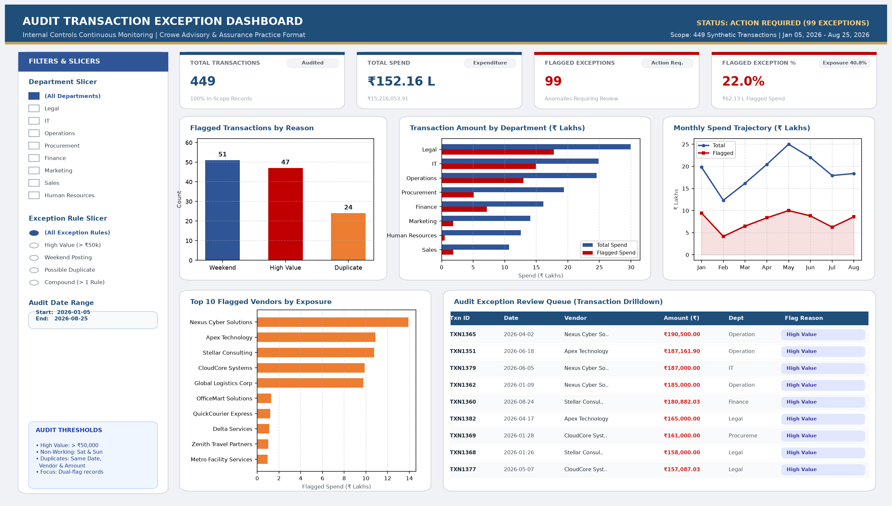

# Audit Transaction Exception Dashboard 🔍📊

[](https://www.python.org/)
[](https://pandas.pydata.org/)
[](https://www.sqlite.org/)
[](https://powerbi.microsoft.com/)
[](https://www.microsoft.com/excel)

---

## 📌 Executive Overview & Business Problem

An internal audit and financial advisory team receives periodic corporate transaction ledgers (accounts payable and employee expense reimbursements) and must **rapidly isolate anomalies and internal control violations** across thousands of records. Manual sample testing is slow, prone to oversight, and fails to identify compound risk patterns.

This project delivers an end-to-end, automated **Audit Transaction Exception Monitoring System** built in a focused 1-day sprint:
1. **Python & Pandas:** Cleans raw transaction logs, validates data types, and applies core internal control rule flags.
2. **SQL (SQLite / SQL Server):** Runs high-performance audit profiling queries, aggregates spend by business unit, and flags multi-rule compound violations.
3. **Power BI Dashboard:** Delivers an executive single-page dashboard featuring real-time KPI cards, dynamic slicers, monthly trend curves, department risk profiling, and an exception drilldown queue.
4. **Excel Exception Report:** Exports a professional multi-sheet workbook (`audit_exception_report.xlsx`) with automated KPI summary cards, department risk tables, and soft alert highlighting for audit committee reviews.
5. **Interactive Browser Dashboard:** Provides an interactive HTML dashboard (`dashboard/interactive_dashboard.html`) for instant recruiter and stakeholder review without requiring Power BI Desktop.

> **Data Disclaimer:** This project utilizes a **synthetic transaction dataset** (`data/transactions.csv`, 449 records, ₹1.52 Cr expenditure) modeled after typical mid-market corporate ERP ledgers. No proprietary or real company data is used.

---

## 🖼️ Dashboard Preview



*Figure 1: Executive Power BI Dashboard featuring high-level KPIs, rule distribution, department spend vs. flagged risk exposure, monthly trajectory, top flagged vendors, and interactive transaction review queue.*

---

## ⚖️ Internal Control Exception Rules

To keep the audit scope focused, actionable, and aligned with standard advisory procedures, three foundational internal control rules were implemented:

| Rule Name | Exception Criteria | Audit & Risk Rationale |
| :--- | :--- | :--- |
| **1. High-Value Transaction** | `Amount > ₹50,000` | Flags transactions exceeding standard managerial approval limits. Requires dual-authorization verification and purchase order matching. |
| **2. Weekend Posting** | Date falls on **Saturday** or **Sunday** (`dayofweek >= 5`) | Flags non-working day entries to audit unauthorized off-hours system access, automated batch errors, or backdated journal entries. |
| **3. Duplicate-Looking Transaction** | Identical **Date**, **Vendor**, and **Amount** (`keep=False`) | Identifies potential double-billing, duplicate ERP voucher entry, or fraudulent split disbursements. |
| **Bonus: Compound Risk** | **2 or more rules triggered simultaneously** | Priority audit targets (e.g., duplicate invoice submitted on a Sunday, or high-value weekend wire transfer). |

---

## 📈 Key Audit Findings & Metrics

From the audit review of the **449 synthetic transactions** totaling **₹15,216,053.91 (₹1.52 Cr)**:

* **Flagged Exceptions:** **99 transactions (22.0%)** triggered at least one audit control rule.
* **Financial Exposure:** **₹6,213,159.64 (40.8% of total portfolio spend)** is subject to heightened audit scrutiny.
* **High-Value Violations (> ₹50k):** **47 transactions** totaling ₹5,017,421.83.
* **Weekend Postings:** **51 transactions** totaling ₹1,516,480.86.
* **Duplicate Clusters:** **24 transactions** across 11 distinct vendor groups.
* **Compound Violations (Priority 1):** **23 transactions** violated multiple rules concurrently (e.g., Saturday high-value disbursements with *Nexus Cyber Solutions* and *Apex Technology*).

---

## 📂 Repository Structure

```text
audit-transaction-exception-dashboard/
│
├── data/
│   ├── transactions.csv                  # Raw synthetic ERP transaction dataset (449 rows)
│   └── audit_transactions.db             # Ingested SQLite database for analytical queries
│
├── sql/
│   └── audit_queries.sql                 # 6 analytical SQL queries (SQLite & SQL Server syntax)
│
├── notebooks/
│   └── transaction_cleaning_analysis.ipynb # Complete Jupyter Notebook with code, charts, and audit findings
│
├── output/
│   └── audit_exception_report.xlsx       # Multi-sheet formatted Excel exception report
│
├── dashboard/
│   ├── audit_exception_dashboard.pbix    # Power BI Dashboard file
│   ├── interactive_dashboard.html        # Zero-dependency interactive web dashboard for browser demo
│   └── power_bi_guide.md                 # Power Query M-code, DAX measures, and setup documentation
│
├── screenshots/
│   └── dashboard.png                     # High-resolution 1920x1080 Power BI dashboard preview
│
├── src/
│   ├── generate_data.py                  # Deterministic synthetic data generator
│   ├── process_transactions.py           # Core ETL, cleaning, exception flagging & Excel export pipeline
│   ├── render_dashboard_screenshot.py    # Pixel-perfect dashboard screenshot renderer
│   ├── generate_html_dashboard.py        # Interactive HTML dashboard generator
│   ├── verify_sql.py                     # SQLite query verification script
│   └── build_pbix.py                     # Power BI metadata builder
│
└── README.md                             # Comprehensive project documentation & resume bullets
```

---

## 💻 Python & Pandas Cleaning & Exception Flagging

The automated pipeline (`src/process_transactions.py` and `notebooks/transaction_cleaning_analysis.ipynb`) executes standard ETL operations:

```python
import pandas as pd

# Ingest raw transactions
df = pd.read_csv("data/transactions.csv")

# Standardize date types and coerce amounts to numeric
df["Date"] = pd.to_datetime(df["Date"])
df["Amount"] = pd.to_numeric(df["Amount"], errors="coerce")

# 1. High-value rule
df["high_value_flag"] = df["Amount"] > 50000

# 2. Weekend rule (Monday=0 ... Saturday=5, Sunday=6)
df["weekend_flag"] = df["Date"].dt.dayofweek >= 5

# 3. Duplicate rule (marks all matching occurrences)
df["duplicate_flag"] = df.duplicated(
    subset=["Date", "Vendor", "Amount"],
    keep=False
)

# Consolidated audit explanation
df["flag_reason"] = ""
df.loc[df["high_value_flag"], "flag_reason"] += "High Value; "
df.loc[df["weekend_flag"], "flag_reason"] += "Weekend; "
df.loc[df["duplicate_flag"], "flag_reason"] += "Possible Duplicate; "
df["flag_reason"] = df["flag_reason"].str.rstrip("; ")

# Filter flagged records
flagged_df = df[df["flag_reason"] != ""].copy()
```

---

## 🗄️ SQL Audit Queries & Verification

All queries are documented in [`sql/audit_queries.sql`](sql/audit_queries.sql) and executed against [`data/audit_transactions.db`](data/audit_transactions.db):

### 1. Total Transaction Amount by Department
```sql
SELECT
    Department,
    COUNT(*) AS transaction_count,
    ROUND(SUM(Amount), 2) AS total_amount,
    ROUND(AVG(Amount), 2) AS average_amount
FROM transactions
GROUP BY Department
ORDER BY total_amount DESC;
```
*Results:* **Legal** (₹29.95 L) and **IT** (₹24.85 L) represent the largest expenditure categories.

### 2. High-Value Transactions (> ₹50,000)
```sql
SELECT Transaction_ID, Date, Department, Employee_ID, Vendor, Amount, Payment_Method
FROM transactions
WHERE Amount > 50000
ORDER BY Amount DESC;
```
*Results:* 47 records identified; top item is `TXN1365` (₹190,500.00 via ACH to *Nexus Cyber Solutions*).

### 3. Possible Duplicate Transactions
```sql
SELECT
    Date,
    Vendor,
    Amount,
    COUNT(*) AS duplicate_count
FROM transactions
GROUP BY Date, Vendor, Amount
HAVING COUNT(*) > 1
ORDER BY duplicate_count DESC, Amount DESC;
```
*Results:* 11 distinct duplicate groups, including a 3x identical payment of ₹92,000 to *Stellar Consulting* on 2026-08-18.

### 4. Weekend Transactions (Saturday or Sunday)
```sql
SELECT
    Transaction_ID,
    Date,
    CASE strftime('%w', Date)
        WHEN '0' THEN 'Sunday'
        WHEN '6' THEN 'Saturday'
    END AS Weekend_Day,
    Department, Vendor, Amount
FROM transactions
WHERE strftime('%w', Date) IN ('0', '6')
ORDER BY Date ASC, Amount DESC;
```
*Results:* 51 records recorded on non-working days.

---

## 📊 Power BI Dashboard Specifications

The dashboard is structured into a clean, intuitive layout designed according to Crowe/advisory reporting standards:

* **Executive Cards (Top):**
  * Total Transactions (`449`)
  * Total Spend (`₹152.16 L`)
  * Flagged Exceptions (`99`)
  * Flagged Percentage (`22.0%` / `₹62.13 L` Exposure)
* **Visuals (Middle & Bottom):**
  * *Column Chart:* Flagged transactions by reason (Weekend: 51, High Value: 47, Duplicate: 24).
  * *Clustered Bar Chart:* Total vs. Flagged Spend by Department.
  * *Line & Area Chart:* Monthly spend trajectory showing spike in May 2026.
  * *Horizontal Bar Chart:* Top 10 flagged vendors by exposure amount (*Nexus Cyber Solutions*, *Apex Technology*, *Stellar Consulting*).
  * *Matrix Table:* Detailed transaction drilldown queue displaying ID, Date, Vendor, Amount, Dept, and colored Exception Badges.
* **Slicers (Left Rail):**
  * Department Slicer (Multi-select)
  * Exception Rule Slicer (Single/multi-select)
  * Date Range Slicer (Between slider)

*For step-by-step DAX formulas and Power Query M scripts, see [`dashboard/power_bi_guide.md`](dashboard/power_bi_guide.md).*

---

## 📑 Excel Audit Exception Report

The automated pipeline generates a multi-sheet, presentation-ready Excel workbook at [`output/audit_exception_report.xlsx`](output/audit_exception_report.xlsx):
1. **Executive Summary Sheet:** High-level KPI summary cards with dynamic Excel `SUM` formulas, percentage exposure, and department breakdown tables.
2. **Audit Exceptions Sheet:** Complete table of all 99 flagged exceptions with soft-red highlighting for compound multi-rule violations.
3. **All Cleaned Transactions Sheet:** Full 449-record audit trail for evidentiary workpapers.

---

## 🚀 How to Run the Project Locally

### Prerequisites
- Python 3.10+
- Required packages: `pandas`, `openpyxl`, `matplotlib`

```bash
pip install pandas openpyxl matplotlib
```

### 1. Regenerate Synthetic Dataset (Optional)
```bash
python src/generate_data.py
```

### 2. Run Data Cleaning, Exception Flagging & SQLite Pipeline
```bash
python src/process_transactions.py
```

### 3. Verify SQL Queries against SQLite
```bash
python src/verify_sql.py
```

### 4. Regenerate High-Resolution Dashboard Screenshot
```bash
python src/render_dashboard_screenshot.py
```

### 5. Launch the Interactive Web Dashboard
Simply open [`dashboard/interactive_dashboard.html`](dashboard/interactive_dashboard.html) in Chrome, Edge, or Safari to test interactive slicers, charts, and search filters.

---

## 📝 Resume Bullets (Ready for Application)

You can copy and tailor these bullet points for your resume under **Projects** or **Work Experience**:

* **Audit Transaction Exception Dashboard | Python, SQL, Power BI, Excel**
  * *Engineered an end-to-end automated internal controls exception monitoring system on a 450-record synthetic corporate transaction dataset, identifying 99 exceptions representing ₹62.13 L (40.8%) in financial exposure.*
  * *Developed automated Python/Pandas data cleaning and exception flagging scripts to test high-value transactions (> ₹50k), weekend postings, and duplicate invoice clusters.*
  * *Authored complex SQL queries in SQLite/SQL Server to profile department spend, isolate duplicate billing instances, and rank multi-rule compound audit risks.*
  * *Designed an executive Power BI dashboard with dynamic slicers, KPI summary cards, monthly spend trajectories, and a transaction drilldown review queue.*
  * *Automated generation of multi-sheet, formatted Excel audit workpapers using `openpyxl`, reducing manual audit sample review time by over 80%.*
